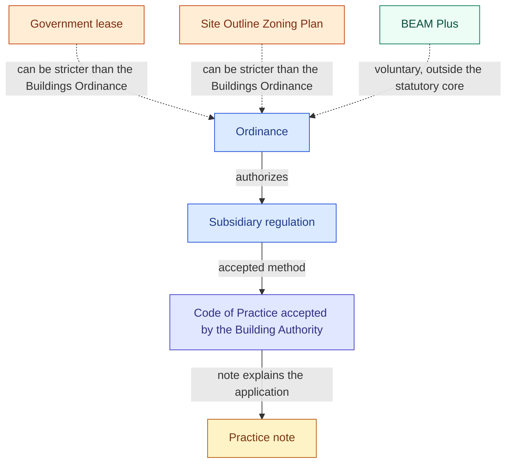
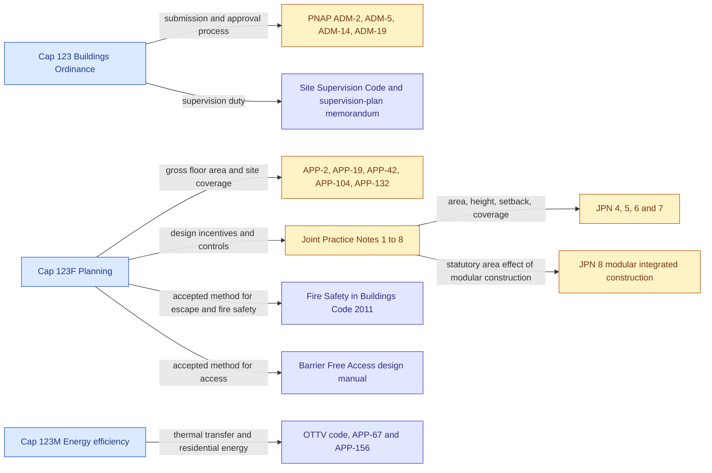

# Relationships between Hong Kong statutory documents for architects

How the instruments in hk_s_reference relate. Legal force runs from ordinance to regulation to an accepted code of practice to a practice note. A government lease and the site outline zoning plan can be stricter than the Buildings Ordinance. Practice notes state how the authority applies the law. They do not replace it.

## Legal force

Strongest instrument first. A Code of Practice is a method the Building Authority has accepted. A practice note explains that application. BEAM Plus (Building Environmental Assessment Method Plus) is a voluntary assessment and sits outside this chain.

<!-- mermaid:id=legal_force -->

## Two different licences

Cap 408, the Architects Registration Ordinance, controls the title Registered Architect through the Architects Registration Board. It does not approve building plans. An Authorized Person is a separate registration with the Building Authority under Cap 123, the Buildings Ordinance.

```mermaid
flowchart LR
  accTitle: Two different licences
  accDescr: Cap 408 leads to the Registered Architect title and does not approve plans. Separate Building Authority registration creates an Authorized Person, who submits and supervises under Cap 123.
  cap408["Cap 408 Architects Registration Ordinance"]
  class cap408 statute
  ra["Registered Architect"]
  class ra person
  ba_reg["Building Authority registration"]
  class ba_reg statute
  ap["Authorized Person"]
  class ap person
  cap123["Cap 123 Buildings Ordinance"]
  class cap123 statute
  plans["Building plan approval"]
  class plans gate
  cap408 -->|controls the title| ra
  ra -.->|title does not approve plans| plans
  ra -->|separate registration| ba_reg
  ba_reg -->|creates the statutory role| ap
  ap -->|submits, supervises, occupation permit| cap123
  ap -->|submits the plans| plans
classDef statute fill:#dbeafe,stroke:#1d4ed8,color:#1e3a8a
classDef person fill:#f3e8ff,stroke:#7e22ce,color:#581c87
classDef gate fill:#ffe4e6,stroke:#be123c,color:#881337
%% portable-canonical-v2:eyJhY2Nlc3NpYmlsaXR5IjoiQ2FwIDQwOCBsZWFkcyB0byB0aGUgUmVnaXN0ZXJlZCBBcmNoaXRlY3QgdGl0bGUgYW5kIGRvZXMgbm90IGFwcHJvdmUgcGxhbnMuIFNlcGFyYXRlIEJ1aWxkaW5nIEF1dGhvcml0eSByZWdpc3RyYXRpb24gY3JlYXRlcyBhbiBBdXRob3JpemVkIFBlcnNvbiwgd2hvIHN1Ym1pdHMgYW5kIHN1cGVydmlzZXMgdW5kZXIgQ2FwIDEyMy4iLCJkYXRhIjp7ImRpcmVjdGlvbiI6IkxSIiwiZWRnZXMiOlt7ImZyb20iOiJjYXA0MDgiLCJsYWJlbCI6ImNvbnRyb2xzIHRoZSB0aXRsZSIsInRvIjoicmEifSx7ImFycm93IjoiLS4tPiIsImZyb20iOiJyYSIsImxhYmVsIjoidGl0bGUgZG9lcyBub3QgYXBwcm92ZSBwbGFucyIsInRvIjoicGxhbnMifSx7ImZyb20iOiJyYSIsImxhYmVsIjoic2VwYXJhdGUgcmVnaXN0cmF0aW9uIiwidG8iOiJiYV9yZWcifSx7ImZyb20iOiJiYV9yZWciLCJsYWJlbCI6ImNyZWF0ZXMgdGhlIHN0YXR1dG9yeSByb2xlIiwidG8iOiJhcCJ9LHsiZnJvbSI6ImFwIiwibGFiZWwiOiJzdWJtaXRzLCBzdXBlcnZpc2VzLCBvY2N1cGF0aW9uIHBlcm1pdCIsInRvIjoiY2FwMTIzIn0seyJmcm9tIjoiYXAiLCJsYWJlbCI6InN1Ym1pdHMgdGhlIHBsYW5zIiwidG8iOiJwbGFucyJ9XSwibm9kZXMiOlt7ImNsYXNzIjoic3RhdHV0ZSIsImlkIjoiY2FwNDA4IiwibGFiZWwiOiJDYXAgNDA4IEFyY2hpdGVjdHMgUmVnaXN0cmF0aW9uIE9yZGluYW5jZSJ9LHsiY2xhc3MiOiJwZXJzb24iLCJpZCI6InJhIiwibGFiZWwiOiJSZWdpc3RlcmVkIEFyY2hpdGVjdCJ9LHsiY2xhc3MiOiJzdGF0dXRlIiwiaWQiOiJiYV9yZWciLCJsYWJlbCI6IkJ1aWxkaW5nIEF1dGhvcml0eSByZWdpc3RyYXRpb24ifSx7ImNsYXNzIjoicGVyc29uIiwiaWQiOiJhcCIsImxhYmVsIjoiQXV0aG9yaXplZCBQZXJzb24ifSx7ImNsYXNzIjoic3RhdHV0ZSIsImlkIjoiY2FwMTIzIiwibGFiZWwiOiJDYXAgMTIzIEJ1aWxkaW5ncyBPcmRpbmFuY2UifSx7ImNsYXNzIjoiZ2F0ZSIsImlkIjoicGxhbnMiLCJsYWJlbCI6IkJ1aWxkaW5nIHBsYW4gYXBwcm92YWwifV19LCJkZXNjcmlwdGlvbiI6IkNhcCA0MDgsIHRoZSBBcmNoaXRlY3RzIFJlZ2lzdHJhdGlvbiBPcmRpbmFuY2UsIGNvbnRyb2xzIHRoZSB0aXRsZSBSZWdpc3RlcmVkIEFyY2hpdGVjdCB0aHJvdWdoIHRoZSBBcmNoaXRlY3RzIFJlZ2lzdHJhdGlvbiBCb2FyZC4gSXQgZG9lcyBub3QgYXBwcm92ZSBidWlsZGluZyBwbGFucy4gQW4gQXV0aG9yaXplZCBQZXJzb24gaXMgYSBzZXBhcmF0ZSByZWdpc3RyYXRpb24gd2l0aCB0aGUgQnVpbGRpbmcgQXV0aG9yaXR5IHVuZGVyIENhcCAxMjMsIHRoZSBCdWlsZGluZ3MgT3JkaW5hbmNlLiIsImlkIjoidHdvX2xpY2VuY2VzIiwia2luZCI6ImZsb3djaGFydCIsInNvdXJjZVNoYTI1NiI6ImZjY2JlMTI2OWQ0MmNjZmMxZDNiYzJkOGFlNTk1Y2JiYzU5OTk4ZGNlMGRhZDljYTQ1Mjg1ZWMzY2IwMTVlYTUiLCJzdHlsZXMiOlt7ImRlZmluaXRpb24iOiJmaWxsOiNkYmVhZmUsc3Ryb2tlOiMxZDRlZDgsY29sb3I6IzFlM2E4YSIsIm5hbWUiOiJzdGF0dXRlIn0seyJkZWZpbml0aW9uIjoiZmlsbDojZjNlOGZmLHN0cm9rZTojN2UyMmNlLGNvbG9yOiM1ODFjODciLCJuYW1lIjoicGVyc29uIn0seyJkZWZpbml0aW9uIjoiZmlsbDojZmZlNGU2LHN0cm9rZTojYmUxMjNjLGNvbG9yOiM4ODEzMzciLCJuYW1lIjoiZ2F0ZSJ9XSwidGl0bGUiOiJUd28gZGlmZmVyZW50IGxpY2VuY2VzIiwidmVyc2lvbiI6MX0
```

<!-- mermaid:id=two_licences -->

## Cap 123 and its subsidiary regulations

Cap 121, the Buildings Ordinance (Application to the New Territories) Ordinance, decides how Cap 123 applies in the New Territories. Cap 123B, the Building (Construction) Regulations, is the earlier construction text. Use it when a project still cites that text. Cap 123Q, the Building (Construction) Regulation, is the later construction regulation.

```mermaid
flowchart TB
  accTitle: Cap 123 and its subsidiary regulations
  accDescr: Cap 123 is the parent ordinance. Cap 121 limits its application in the New Territories. The lettered regulations cover administration, planning, construction, energy, sanitation, refuse, minor works, inspection, and other specialist duties.
  cap123["Cap 123 Buildings Ordinance"]
  class cap123 statute
  cap121["Cap 121 New Territories application"]
  class cap121 statute
  cap123a["Cap 123A Administration"]
  class cap123a statute
  cap123f["Cap 123F Planning"]
  class cap123f statute
  cap123q["Cap 123Q Construction"]
  class cap123q statute
  cap123b["Cap 123B earlier construction text"]
  class cap123b older
  cap123m["Cap 123M Energy efficiency"]
  class cap123m statute
  cap123i["Cap 123I Sanitary fitments, plumbing and drainage"]
  class cap123i statute
  cap123h["Cap 123H Refuse storage"]
  class cap123h statute
  cap123n["Cap 123N Minor works"]
  class cap123n statute
  cap123p["Cap 123P Inspection and repair"]
  class cap123p statute
  cap123other["Cap 123C, D, E, G, J, K, L and O"]
  class cap123other statute
  cap121 -.->|Cap 123 applies in the New Territories only as Cap 121 provides| cap123
  cap123 -->|plan packages and forms| cap123a
  cap123 -->|site coverage, plot ratio, streets, light, projections, escape| cap123f
  cap123 -->|materials and construction| cap123q
  cap123b -.->|use the earlier text only when the project cites it| cap123q
  cap123 -->|overall thermal transfer value| cap123m
  cap123 -->|sanitary and drainage| cap123i
  cap123 -->|refuse| cap123h
  cap123 -->|minor works instead of full approval| cap123n
  cap123 -->|mandatory inspection of existing buildings| cap123p
  cap123 -->|demolition, escalators, lifts, streets, ventilation, oil, appeals, fees| cap123other
classDef statute fill:#dbeafe,stroke:#1d4ed8,color:#1e3a8a
classDef older fill:#f1f5f9,stroke:#475569,color:#0f172a
%% portable-canonical-v2:eyJhY2Nlc3NpYmlsaXR5IjoiQ2FwIDEyMyBpcyB0aGUgcGFyZW50IG9yZGluYW5jZS4gQ2FwIDEyMSBsaW1pdHMgaXRzIGFwcGxpY2F0aW9uIGluIHRoZSBOZXcgVGVycml0b3JpZXMuIFRoZSBsZXR0ZXJlZCByZWd1bGF0aW9ucyBjb3ZlciBhZG1pbmlzdHJhdGlvbiwgcGxhbm5pbmcsIGNvbnN0cnVjdGlvbiwgZW5lcmd5LCBzYW5pdGF0aW9uLCByZWZ1c2UsIG1pbm9yIHdvcmtzLCBpbnNwZWN0aW9uLCBhbmQgb3RoZXIgc3BlY2lhbGlzdCBkdXRpZXMuIiwiZGF0YSI6eyJkaXJlY3Rpb24iOiJUQiIsImVkZ2VzIjpbeyJhcnJvdyI6Ii0uLT4iLCJmcm9tIjoiY2FwMTIxIiwibGFiZWwiOiJDYXAgMTIzIGFwcGxpZXMgaW4gdGhlIE5ldyBUZXJyaXRvcmllcyBvbmx5IGFzIENhcCAxMjEgcHJvdmlkZXMiLCJ0byI6ImNhcDEyMyJ9LHsiZnJvbSI6ImNhcDEyMyIsImxhYmVsIjoicGxhbiBwYWNrYWdlcyBhbmQgZm9ybXMiLCJ0byI6ImNhcDEyM2EifSx7ImZyb20iOiJjYXAxMjMiLCJsYWJlbCI6InNpdGUgY292ZXJhZ2UsIHBsb3QgcmF0aW8sIHN0cmVldHMsIGxpZ2h0LCBwcm9qZWN0aW9ucywgZXNjYXBlIiwidG8iOiJjYXAxMjNmIn0seyJmcm9tIjoiY2FwMTIzIiwibGFiZWwiOiJtYXRlcmlhbHMgYW5kIGNvbnN0cnVjdGlvbiIsInRvIjoiY2FwMTIzcSJ9LHsiYXJyb3ciOiItLi0-IiwiZnJvbSI6ImNhcDEyM2IiLCJsYWJlbCI6InVzZSB0aGUgZWFybGllciB0ZXh0IG9ubHkgd2hlbiB0aGUgcHJvamVjdCBjaXRlcyBpdCIsInRvIjoiY2FwMTIzcSJ9LHsiZnJvbSI6ImNhcDEyMyIsImxhYmVsIjoib3ZlcmFsbCB0aGVybWFsIHRyYW5zZmVyIHZhbHVlIiwidG8iOiJjYXAxMjNtIn0seyJmcm9tIjoiY2FwMTIzIiwibGFiZWwiOiJzYW5pdGFyeSBhbmQgZHJhaW5hZ2UiLCJ0byI6ImNhcDEyM2kifSx7ImZyb20iOiJjYXAxMjMiLCJsYWJlbCI6InJlZnVzZSIsInRvIjoiY2FwMTIzaCJ9LHsiZnJvbSI6ImNhcDEyMyIsImxhYmVsIjoibWlub3Igd29ya3MgaW5zdGVhZCBvZiBmdWxsIGFwcHJvdmFsIiwidG8iOiJjYXAxMjNuIn0seyJmcm9tIjoiY2FwMTIzIiwibGFiZWwiOiJtYW5kYXRvcnkgaW5zcGVjdGlvbiBvZiBleGlzdGluZyBidWlsZGluZ3MiLCJ0byI6ImNhcDEyM3AifSx7ImZyb20iOiJjYXAxMjMiLCJsYWJlbCI6ImRlbW9saXRpb24sIGVzY2FsYXRvcnMsIGxpZnRzLCBzdHJlZXRzLCB2ZW50aWxhdGlvbiwgb2lsLCBhcHBlYWxzLCBmZWVzIiwidG8iOiJjYXAxMjNvdGhlciJ9XSwibm9kZXMiOlt7ImNsYXNzIjoic3RhdHV0ZSIsImlkIjoiY2FwMTIzIiwibGFiZWwiOiJDYXAgMTIzIEJ1aWxkaW5ncyBPcmRpbmFuY2UifSx7ImNsYXNzIjoic3RhdHV0ZSIsImlkIjoiY2FwMTIxIiwibGFiZWwiOiJDYXAgMTIxIE5ldyBUZXJyaXRvcmllcyBhcHBsaWNhdGlvbiJ9LHsiY2xhc3MiOiJzdGF0dXRlIiwiaWQiOiJjYXAxMjNhIiwibGFiZWwiOiJDYXAgMTIzQSBBZG1pbmlzdHJhdGlvbiJ9LHsiY2xhc3MiOiJzdGF0dXRlIiwiaWQiOiJjYXAxMjNmIiwibGFiZWwiOiJDYXAgMTIzRiBQbGFubmluZyJ9LHsiY2xhc3MiOiJzdGF0dXRlIiwiaWQiOiJjYXAxMjNxIiwibGFiZWwiOiJDYXAgMTIzUSBDb25zdHJ1Y3Rpb24ifSx7ImNsYXNzIjoib2xkZXIiLCJpZCI6ImNhcDEyM2IiLCJsYWJlbCI6IkNhcCAxMjNCIGVhcmxpZXIgY29uc3RydWN0aW9uIHRleHQifSx7ImNsYXNzIjoic3RhdHV0ZSIsImlkIjoiY2FwMTIzbSIsImxhYmVsIjoiQ2FwIDEyM00gRW5lcmd5IGVmZmljaWVuY3kifSx7ImNsYXNzIjoic3RhdHV0ZSIsImlkIjoiY2FwMTIzaSIsImxhYmVsIjoiQ2FwIDEyM0kgU2FuaXRhcnkgZml0bWVudHMsIHBsdW1iaW5nIGFuZCBkcmFpbmFnZSJ9LHsiY2xhc3MiOiJzdGF0dXRlIiwiaWQiOiJjYXAxMjNoIiwibGFiZWwiOiJDYXAgMTIzSCBSZWZ1c2Ugc3RvcmFnZSJ9LHsiY2xhc3MiOiJzdGF0dXRlIiwiaWQiOiJjYXAxMjNuIiwibGFiZWwiOiJDYXAgMTIzTiBNaW5vciB3b3JrcyJ9LHsiY2xhc3MiOiJzdGF0dXRlIiwiaWQiOiJjYXAxMjNwIiwibGFiZWwiOiJDYXAgMTIzUCBJbnNwZWN0aW9uIGFuZCByZXBhaXIifSx7ImNsYXNzIjoic3RhdHV0ZSIsImlkIjoiY2FwMTIzb3RoZXIiLCJsYWJlbCI6IkNhcCAxMjNDLCBELCBFLCBHLCBKLCBLLCBMIGFuZCBPIn1dfSwiZGVzY3JpcHRpb24iOiJDYXAgMTIxLCB0aGUgQnVpbGRpbmdzIE9yZGluYW5jZSAoQXBwbGljYXRpb24gdG8gdGhlIE5ldyBUZXJyaXRvcmllcykgT3JkaW5hbmNlLCBkZWNpZGVzIGhvdyBDYXAgMTIzIGFwcGxpZXMgaW4gdGhlIE5ldyBUZXJyaXRvcmllcy4gQ2FwIDEyM0IsIHRoZSBCdWlsZGluZyAoQ29uc3RydWN0aW9uKSBSZWd1bGF0aW9ucywgaXMgdGhlIGVhcmxpZXIgY29uc3RydWN0aW9uIHRleHQuIFVzZSBpdCB3aGVuIGEgcHJvamVjdCBzdGlsbCBjaXRlcyB0aGF0IHRleHQuIENhcCAxMjNRLCB0aGUgQnVpbGRpbmcgKENvbnN0cnVjdGlvbikgUmVndWxhdGlvbiwgaXMgdGhlIGxhdGVyIGNvbnN0cnVjdGlvbiByZWd1bGF0aW9uLiIsImlkIjoiY2FwMTIzX2ZhbWlseSIsImtpbmQiOiJmbG93Y2hhcnQiLCJzb3VyY2VTaGEyNTYiOiJkMmU4OTNhNDI3OTQ2NDM3MTM5MzhmOWI4OTc4M2Q2ODQ4YWE2MThmZGEyNTM1NGFmYmRhMWY0ZDA5YWMxYWVhIiwic3R5bGVzIjpbeyJkZWZpbml0aW9uIjoiZmlsbDojZGJlYWZlLHN0cm9rZTojMWQ0ZWQ4LGNvbG9yOiMxZTNhOGEiLCJuYW1lIjoic3RhdHV0ZSJ9LHsiZGVmaW5pdGlvbiI6ImZpbGw6I2YxZjVmOSxzdHJva2U6IzQ3NTU2OSxjb2xvcjojMGYxNzJhIiwibmFtZSI6Im9sZGVyIn1dLCJ0aXRsZSI6IkNhcCAxMjMgYW5kIGl0cyBzdWJzaWRpYXJ5IHJlZ3VsYXRpb25zIiwidmVyc2lvbiI6MX0
```

<!-- mermaid:id=cap123_family -->

## How the Building Authority applies Cap 123

Practice Notes for Authorized Persons and Joint Practice Notes state how the Building Authority applies the ordinance. Joint Practice Notes 4, 5, 6 and 7 change gross floor area, height, setback and site coverage. Joint Practice Note 8 is the statutory gross floor area effect of modular integrated construction.

<!-- mermaid:id=how_applied -->

## What actually limits the site

A master schedule of Notes is a standard form. It is not the site Outline Zoning Plan. The Hong Kong Planning Standards and Guidelines are guidance. On a real site, the site plan, its Notes, and the government lease control the envelope and can be tighter than Cap 123.

```mermaid
flowchart LR
  accTitle: What actually limits the site
  accDescr: Cap 123, the site outline zoning plan, and the government lease all feed the site envelope. The master schedule and the planning standards do not replace the site plan.
  cap131["Cap 131 Town Planning Ordinance"]
  class cap131 statute
  master["OZP master schedule of Notes"]
  class master practice
  hkpsg["Hong Kong Planning Standards and Guidelines"]
  class hkpsg guidance
  site_ozp["Site Outline Zoning Plan and its Notes"]
  class site_ozp control
  lease["Government lease"]
  class lease control
  cap123["Cap 123 bulk and height rules"]
  class cap123 statute
  envelope["Development envelope on the site"]
  class envelope control
  cap131 -->|the plan that applies to the lot| site_ozp
  master -.->|standard wording, not the site plan| site_ozp
  hkpsg -.->|guidance, not the statutory plan| site_ozp
  site_ozp -->|can be stricter than Cap 123| envelope
  lease -->|can be stricter than Cap 123| envelope
  cap123 -->|building control| envelope
classDef statute fill:#dbeafe,stroke:#1d4ed8,color:#1e3a8a
classDef practice fill:#fef3c7,stroke:#b45309,color:#78350f
classDef control fill:#ffedd5,stroke:#c2410c,color:#7c2d12
classDef guidance fill:#ecfdf5,stroke:#047857,color:#064e3b
%% portable-canonical-v2:eyJhY2Nlc3NpYmlsaXR5IjoiQ2FwIDEyMywgdGhlIHNpdGUgb3V0bGluZSB6b25pbmcgcGxhbiwgYW5kIHRoZSBnb3Zlcm5tZW50IGxlYXNlIGFsbCBmZWVkIHRoZSBzaXRlIGVudmVsb3BlLiBUaGUgbWFzdGVyIHNjaGVkdWxlIGFuZCB0aGUgcGxhbm5pbmcgc3RhbmRhcmRzIGRvIG5vdCByZXBsYWNlIHRoZSBzaXRlIHBsYW4uIiwiZGF0YSI6eyJkaXJlY3Rpb24iOiJMUiIsImVkZ2VzIjpbeyJmcm9tIjoiY2FwMTMxIiwibGFiZWwiOiJ0aGUgcGxhbiB0aGF0IGFwcGxpZXMgdG8gdGhlIGxvdCIsInRvIjoic2l0ZV9venAifSx7ImFycm93IjoiLS4tPiIsImZyb20iOiJtYXN0ZXIiLCJsYWJlbCI6InN0YW5kYXJkIHdvcmRpbmcsIG5vdCB0aGUgc2l0ZSBwbGFuIiwidG8iOiJzaXRlX296cCJ9LHsiYXJyb3ciOiItLi0-IiwiZnJvbSI6ImhrcHNnIiwibGFiZWwiOiJndWlkYW5jZSwgbm90IHRoZSBzdGF0dXRvcnkgcGxhbiIsInRvIjoic2l0ZV9venAifSx7ImZyb20iOiJzaXRlX296cCIsImxhYmVsIjoiY2FuIGJlIHN0cmljdGVyIHRoYW4gQ2FwIDEyMyIsInRvIjoiZW52ZWxvcGUifSx7ImZyb20iOiJsZWFzZSIsImxhYmVsIjoiY2FuIGJlIHN0cmljdGVyIHRoYW4gQ2FwIDEyMyIsInRvIjoiZW52ZWxvcGUifSx7ImZyb20iOiJjYXAxMjMiLCJsYWJlbCI6ImJ1aWxkaW5nIGNvbnRyb2wiLCJ0byI6ImVudmVsb3BlIn1dLCJub2RlcyI6W3siY2xhc3MiOiJzdGF0dXRlIiwiaWQiOiJjYXAxMzEiLCJsYWJlbCI6IkNhcCAxMzEgVG93biBQbGFubmluZyBPcmRpbmFuY2UifSx7ImNsYXNzIjoicHJhY3RpY2UiLCJpZCI6Im1hc3RlciIsImxhYmVsIjoiT1pQIG1hc3RlciBzY2hlZHVsZSBvZiBOb3RlcyJ9LHsiY2xhc3MiOiJndWlkYW5jZSIsImlkIjoiaGtwc2ciLCJsYWJlbCI6IkhvbmcgS29uZyBQbGFubmluZyBTdGFuZGFyZHMgYW5kIEd1aWRlbGluZXMifSx7ImNsYXNzIjoiY29udHJvbCIsImlkIjoic2l0ZV9venAiLCJsYWJlbCI6IlNpdGUgT3V0bGluZSBab25pbmcgUGxhbiBhbmQgaXRzIE5vdGVzIn0seyJjbGFzcyI6ImNvbnRyb2wiLCJpZCI6ImxlYXNlIiwibGFiZWwiOiJHb3Zlcm5tZW50IGxlYXNlIn0seyJjbGFzcyI6InN0YXR1dGUiLCJpZCI6ImNhcDEyMyIsImxhYmVsIjoiQ2FwIDEyMyBidWxrIGFuZCBoZWlnaHQgcnVsZXMifSx7ImNsYXNzIjoiY29udHJvbCIsImlkIjoiZW52ZWxvcGUiLCJsYWJlbCI6IkRldmVsb3BtZW50IGVudmVsb3BlIG9uIHRoZSBzaXRlIn1dfSwiZGVzY3JpcHRpb24iOiJBIG1hc3RlciBzY2hlZHVsZSBvZiBOb3RlcyBpcyBhIHN0YW5kYXJkIGZvcm0uIEl0IGlzIG5vdCB0aGUgc2l0ZSBPdXRsaW5lIFpvbmluZyBQbGFuLiBUaGUgSG9uZyBLb25nIFBsYW5uaW5nIFN0YW5kYXJkcyBhbmQgR3VpZGVsaW5lcyBhcmUgZ3VpZGFuY2UuIE9uIGEgcmVhbCBzaXRlLCB0aGUgc2l0ZSBwbGFuLCBpdHMgTm90ZXMsIGFuZCB0aGUgZ292ZXJubWVudCBsZWFzZSBjb250cm9sIHRoZSBlbnZlbG9wZSBhbmQgY2FuIGJlIHRpZ2h0ZXIgdGhhbiBDYXAgMTIzLiIsImlkIjoic2l0ZV9lbnZlbG9wZSIsImtpbmQiOiJmbG93Y2hhcnQiLCJzb3VyY2VTaGEyNTYiOiIzMmRiNDcxODhhMmZiN2ZjNmVjNTA2NjJhYmI5NGZiZTZjZjUxNmM2YjU3OWY3MjM3NmYxY2E2MWU5NjQyOTAyIiwic3R5bGVzIjpbeyJkZWZpbml0aW9uIjoiZmlsbDojZGJlYWZlLHN0cm9rZTojMWQ0ZWQ4LGNvbG9yOiMxZTNhOGEiLCJuYW1lIjoic3RhdHV0ZSJ9LHsiZGVmaW5pdGlvbiI6ImZpbGw6I2ZlZjNjNyxzdHJva2U6I2I0NTMwOSxjb2xvcjojNzgzNTBmIiwibmFtZSI6InByYWN0aWNlIn0seyJkZWZpbml0aW9uIjoiZmlsbDojZmZlZGQ1LHN0cm9rZTojYzI0MTBjLGNvbG9yOiM3YzJkMTIiLCJuYW1lIjoiY29udHJvbCJ9LHsiZGVmaW5pdGlvbiI6ImZpbGw6I2VjZmRmNSxzdHJva2U6IzA0Nzg1Nyxjb2xvcjojMDY0ZTNiIiwibmFtZSI6Imd1aWRhbmNlIn1dLCJ0aXRsZSI6IldoYXQgYWN0dWFsbHkgbGltaXRzIHRoZSBzaXRlIiwidmVyc2lvbiI6MX0
```

<!-- mermaid:id=site_envelope -->

## Regimes that sit beside Cap 123

These ordinances can still constrain a scheme after the Buildings Ordinance is satisfied. Lease control is in the previous diagram. Cap 610, the Buildings Energy Efficiency Ordinance, is the building-services energy code. It is not Cap 123M, which is the overall thermal transfer value regime. Cap 618, the Lifts and Escalators Ordinance, is administered with the Electrical and Mechanical Services Department, alongside Cap 123D and Cap 123E.

```mermaid
flowchart TB
  accTitle: Regimes that sit beside Cap 123
  accDescr: A scheme that meets Cap 123 still faces planning, fire services, pollution, airport height, existing-building fire safety, energy, lifts, water, labour safety, and antiquities controls.
  scheme["Scheme that meets Cap 123"]
  class scheme hub
  pland["Cap 131 Town Planning Ordinance"]
  class pland statute
  fsd["Cap 95 and the fire service installation code"]
  class fsd statute
  epd["Cap 311, Cap 358, Cap 400 and Cap 499"]
  class epd statute
  cad["Cap 301 airport height"]
  class cad statute
  exist["Cap 502, Cap 572 and Cap 636"]
  class exist statute
  energy["Cap 610 building energy code"]
  class energy statute
  lifts["Cap 618 lifts and escalators"]
  class lifts statute
  water["Cap 102 waterworks"]
  class water statute
  labour["Cap 59 and Cap 509"]
  class labour statute
  amo["Cap 53 antiquities"]
  class amo statute
  scheme -->|zoning can still block the use| pland
  scheme -->|installation acceptance is separate from the occupation permit| fsd
  scheme -->|pollution control and designated-project assessment| epd
  scheme -->|height limit near the airport| cad
  scheme -->|fire safety of existing buildings| exist
  scheme -->|services energy code, separate from Cap 123M| energy
  scheme -->|alongside Cap 123D and Cap 123E| lifts
  scheme -->|supply connection and plumbing| water
  scheme -->|site safety duty, not plan approval| labour
  scheme -->|when the site is a monument| amo
classDef statute fill:#dbeafe,stroke:#1d4ed8,color:#1e3a8a
classDef hub fill:#ffe4e6,stroke:#be123c,color:#881337
%% portable-canonical-v2:eyJhY2Nlc3NpYmlsaXR5IjoiQSBzY2hlbWUgdGhhdCBtZWV0cyBDYXAgMTIzIHN0aWxsIGZhY2VzIHBsYW5uaW5nLCBmaXJlIHNlcnZpY2VzLCBwb2xsdXRpb24sIGFpcnBvcnQgaGVpZ2h0LCBleGlzdGluZy1idWlsZGluZyBmaXJlIHNhZmV0eSwgZW5lcmd5LCBsaWZ0cywgd2F0ZXIsIGxhYm91ciBzYWZldHksIGFuZCBhbnRpcXVpdGllcyBjb250cm9scy4iLCJkYXRhIjp7ImRpcmVjdGlvbiI6IlRCIiwiZWRnZXMiOlt7ImZyb20iOiJzY2hlbWUiLCJsYWJlbCI6InpvbmluZyBjYW4gc3RpbGwgYmxvY2sgdGhlIHVzZSIsInRvIjoicGxhbmQifSx7ImZyb20iOiJzY2hlbWUiLCJsYWJlbCI6Imluc3RhbGxhdGlvbiBhY2NlcHRhbmNlIGlzIHNlcGFyYXRlIGZyb20gdGhlIG9jY3VwYXRpb24gcGVybWl0IiwidG8iOiJmc2QifSx7ImZyb20iOiJzY2hlbWUiLCJsYWJlbCI6InBvbGx1dGlvbiBjb250cm9sIGFuZCBkZXNpZ25hdGVkLXByb2plY3QgYXNzZXNzbWVudCIsInRvIjoiZXBkIn0seyJmcm9tIjoic2NoZW1lIiwibGFiZWwiOiJoZWlnaHQgbGltaXQgbmVhciB0aGUgYWlycG9ydCIsInRvIjoiY2FkIn0seyJmcm9tIjoic2NoZW1lIiwibGFiZWwiOiJmaXJlIHNhZmV0eSBvZiBleGlzdGluZyBidWlsZGluZ3MiLCJ0byI6ImV4aXN0In0seyJmcm9tIjoic2NoZW1lIiwibGFiZWwiOiJzZXJ2aWNlcyBlbmVyZ3kgY29kZSwgc2VwYXJhdGUgZnJvbSBDYXAgMTIzTSIsInRvIjoiZW5lcmd5In0seyJmcm9tIjoic2NoZW1lIiwibGFiZWwiOiJhbG9uZ3NpZGUgQ2FwIDEyM0QgYW5kIENhcCAxMjNFIiwidG8iOiJsaWZ0cyJ9LHsiZnJvbSI6InNjaGVtZSIsImxhYmVsIjoic3VwcGx5IGNvbm5lY3Rpb24gYW5kIHBsdW1iaW5nIiwidG8iOiJ3YXRlciJ9LHsiZnJvbSI6InNjaGVtZSIsImxhYmVsIjoic2l0ZSBzYWZldHkgZHV0eSwgbm90IHBsYW4gYXBwcm92YWwiLCJ0byI6ImxhYm91ciJ9LHsiZnJvbSI6InNjaGVtZSIsImxhYmVsIjoid2hlbiB0aGUgc2l0ZSBpcyBhIG1vbnVtZW50IiwidG8iOiJhbW8ifV0sIm5vZGVzIjpbeyJjbGFzcyI6Imh1YiIsImlkIjoic2NoZW1lIiwibGFiZWwiOiJTY2hlbWUgdGhhdCBtZWV0cyBDYXAgMTIzIn0seyJjbGFzcyI6InN0YXR1dGUiLCJpZCI6InBsYW5kIiwibGFiZWwiOiJDYXAgMTMxIFRvd24gUGxhbm5pbmcgT3JkaW5hbmNlIn0seyJjbGFzcyI6InN0YXR1dGUiLCJpZCI6ImZzZCIsImxhYmVsIjoiQ2FwIDk1IGFuZCB0aGUgZmlyZSBzZXJ2aWNlIGluc3RhbGxhdGlvbiBjb2RlIn0seyJjbGFzcyI6InN0YXR1dGUiLCJpZCI6ImVwZCIsImxhYmVsIjoiQ2FwIDMxMSwgQ2FwIDM1OCwgQ2FwIDQwMCBhbmQgQ2FwIDQ5OSJ9LHsiY2xhc3MiOiJzdGF0dXRlIiwiaWQiOiJjYWQiLCJsYWJlbCI6IkNhcCAzMDEgYWlycG9ydCBoZWlnaHQifSx7ImNsYXNzIjoic3RhdHV0ZSIsImlkIjoiZXhpc3QiLCJsYWJlbCI6IkNhcCA1MDIsIENhcCA1NzIgYW5kIENhcCA2MzYifSx7ImNsYXNzIjoic3RhdHV0ZSIsImlkIjoiZW5lcmd5IiwibGFiZWwiOiJDYXAgNjEwIGJ1aWxkaW5nIGVuZXJneSBjb2RlIn0seyJjbGFzcyI6InN0YXR1dGUiLCJpZCI6ImxpZnRzIiwibGFiZWwiOiJDYXAgNjE4IGxpZnRzIGFuZCBlc2NhbGF0b3JzIn0seyJjbGFzcyI6InN0YXR1dGUiLCJpZCI6IndhdGVyIiwibGFiZWwiOiJDYXAgMTAyIHdhdGVyd29ya3MifSx7ImNsYXNzIjoic3RhdHV0ZSIsImlkIjoibGFib3VyIiwibGFiZWwiOiJDYXAgNTkgYW5kIENhcCA1MDkifSx7ImNsYXNzIjoic3RhdHV0ZSIsImlkIjoiYW1vIiwibGFiZWwiOiJDYXAgNTMgYW50aXF1aXRpZXMifV19LCJkZXNjcmlwdGlvbiI6IlRoZXNlIG9yZGluYW5jZXMgY2FuIHN0aWxsIGNvbnN0cmFpbiBhIHNjaGVtZSBhZnRlciB0aGUgQnVpbGRpbmdzIE9yZGluYW5jZSBpcyBzYXRpc2ZpZWQuIExlYXNlIGNvbnRyb2wgaXMgaW4gdGhlIHByZXZpb3VzIGRpYWdyYW0uIENhcCA2MTAsIHRoZSBCdWlsZGluZ3MgRW5lcmd5IEVmZmljaWVuY3kgT3JkaW5hbmNlLCBpcyB0aGUgYnVpbGRpbmctc2VydmljZXMgZW5lcmd5IGNvZGUuIEl0IGlzIG5vdCBDYXAgMTIzTSwgd2hpY2ggaXMgdGhlIG92ZXJhbGwgdGhlcm1hbCB0cmFuc2ZlciB2YWx1ZSByZWdpbWUuIENhcCA2MTgsIHRoZSBMaWZ0cyBhbmQgRXNjYWxhdG9ycyBPcmRpbmFuY2UsIGlzIGFkbWluaXN0ZXJlZCB3aXRoIHRoZSBFbGVjdHJpY2FsIGFuZCBNZWNoYW5pY2FsIFNlcnZpY2VzIERlcGFydG1lbnQsIGFsb25nc2lkZSBDYXAgMTIzRCBhbmQgQ2FwIDEyM0UuIiwiaWQiOiJiZXNpZGVfY2FwMTIzIiwia2luZCI6ImZsb3djaGFydCIsInNvdXJjZVNoYTI1NiI6ImUwNGMzZWMxNjRjYWNiOGQwMGMyZTU2NjYyMDU5NDZhYmUzODdkODYwMGI2ZDkxZTg0ODFiNzI0NzQwODExZTciLCJzdHlsZXMiOlt7ImRlZmluaXRpb24iOiJmaWxsOiNkYmVhZmUsc3Ryb2tlOiMxZDRlZDgsY29sb3I6IzFlM2E4YSIsIm5hbWUiOiJzdGF0dXRlIn0seyJkZWZpbml0aW9uIjoiZmlsbDojZmZlNGU2LHN0cm9rZTojYmUxMjNjLGNvbG9yOiM4ODEzMzciLCJuYW1lIjoiaHViIn1dLCJ0aXRsZSI6IlJlZ2ltZXMgdGhhdCBzaXQgYmVzaWRlIENhcCAxMjMiLCJ2ZXJzaW9uIjoxfQ
```

<!-- mermaid:id=beside_cap123 -->

## Path from appointment to occupation permit

The statutory job under Cap 123. The Authorized Person, Registered Structural Engineer, Registered Geotechnical Engineer and registered contractor are appointed first. Section 14 is approval and consent. Section 16 is refusal. Section 21 is the occupation permit. Fire Services Department acceptance of fire service installations is a parallel gate. It is not itself the occupation permit.

```mermaid
flowchart LR
  accTitle: Path from appointment to occupation permit
  accDescr: Appointment leads to plan submission, then section 14 consent or section 16 refusal. Consent leads through supervision and completion to the section 21 occupation permit. Fire services acceptance runs beside completion.
  appoint["Appoint AP, RSE, RGE and registered contractor"]
  class appoint step
  submit["Plan submission under Cap 123A"]
  class submit step
  s14["Section 14 approval and consent"]
  class s14 step
  s16["Section 16 refusal"]
  class s16 stop
  works["Supervision plan and site supervision code"]
  class works step
  complete["Completion and record plans under APP-13"]
  class complete step
  op["Section 21 occupation permit"]
  class op step
  fsd["FSD inspection of fire service installations"]
  class fsd parallel
  appoint -->|statutory team in place| submit
  submit -->|Building Authority may approve| s14
  submit -.->|Building Authority may refuse| s16
  s14 -->|consent to commence| works
  works -->|works finished| complete
  complete -->|occupation permit application| op
  complete -.->|parallel acceptance, not the permit itself| fsd
classDef step fill:#dbeafe,stroke:#1d4ed8,color:#1e3a8a
classDef stop fill:#ffe4e6,stroke:#be123c,color:#881337
classDef parallel fill:#ffedd5,stroke:#c2410c,color:#7c2d12
%% portable-canonical-v2:eyJhY2Nlc3NpYmlsaXR5IjoiQXBwb2ludG1lbnQgbGVhZHMgdG8gcGxhbiBzdWJtaXNzaW9uLCB0aGVuIHNlY3Rpb24gMTQgY29uc2VudCBvciBzZWN0aW9uIDE2IHJlZnVzYWwuIENvbnNlbnQgbGVhZHMgdGhyb3VnaCBzdXBlcnZpc2lvbiBhbmQgY29tcGxldGlvbiB0byB0aGUgc2VjdGlvbiAyMSBvY2N1cGF0aW9uIHBlcm1pdC4gRmlyZSBzZXJ2aWNlcyBhY2NlcHRhbmNlIHJ1bnMgYmVzaWRlIGNvbXBsZXRpb24uIiwiZGF0YSI6eyJkaXJlY3Rpb24iOiJMUiIsImVkZ2VzIjpbeyJmcm9tIjoiYXBwb2ludCIsImxhYmVsIjoic3RhdHV0b3J5IHRlYW0gaW4gcGxhY2UiLCJ0byI6InN1Ym1pdCJ9LHsiZnJvbSI6InN1Ym1pdCIsImxhYmVsIjoiQnVpbGRpbmcgQXV0aG9yaXR5IG1heSBhcHByb3ZlIiwidG8iOiJzMTQifSx7ImFycm93IjoiLS4tPiIsImZyb20iOiJzdWJtaXQiLCJsYWJlbCI6IkJ1aWxkaW5nIEF1dGhvcml0eSBtYXkgcmVmdXNlIiwidG8iOiJzMTYifSx7ImZyb20iOiJzMTQiLCJsYWJlbCI6ImNvbnNlbnQgdG8gY29tbWVuY2UiLCJ0byI6IndvcmtzIn0seyJmcm9tIjoid29ya3MiLCJsYWJlbCI6IndvcmtzIGZpbmlzaGVkIiwidG8iOiJjb21wbGV0ZSJ9LHsiZnJvbSI6ImNvbXBsZXRlIiwibGFiZWwiOiJvY2N1cGF0aW9uIHBlcm1pdCBhcHBsaWNhdGlvbiIsInRvIjoib3AifSx7ImFycm93IjoiLS4tPiIsImZyb20iOiJjb21wbGV0ZSIsImxhYmVsIjoicGFyYWxsZWwgYWNjZXB0YW5jZSwgbm90IHRoZSBwZXJtaXQgaXRzZWxmIiwidG8iOiJmc2QifV0sIm5vZGVzIjpbeyJjbGFzcyI6InN0ZXAiLCJpZCI6ImFwcG9pbnQiLCJsYWJlbCI6IkFwcG9pbnQgQVAsIFJTRSwgUkdFIGFuZCByZWdpc3RlcmVkIGNvbnRyYWN0b3IifSx7ImNsYXNzIjoic3RlcCIsImlkIjoic3VibWl0IiwibGFiZWwiOiJQbGFuIHN1Ym1pc3Npb24gdW5kZXIgQ2FwIDEyM0EifSx7ImNsYXNzIjoic3RlcCIsImlkIjoiczE0IiwibGFiZWwiOiJTZWN0aW9uIDE0IGFwcHJvdmFsIGFuZCBjb25zZW50In0seyJjbGFzcyI6InN0b3AiLCJpZCI6InMxNiIsImxhYmVsIjoiU2VjdGlvbiAxNiByZWZ1c2FsIn0seyJjbGFzcyI6InN0ZXAiLCJpZCI6IndvcmtzIiwibGFiZWwiOiJTdXBlcnZpc2lvbiBwbGFuIGFuZCBzaXRlIHN1cGVydmlzaW9uIGNvZGUifSx7ImNsYXNzIjoic3RlcCIsImlkIjoiY29tcGxldGUiLCJsYWJlbCI6IkNvbXBsZXRpb24gYW5kIHJlY29yZCBwbGFucyB1bmRlciBBUFAtMTMifSx7ImNsYXNzIjoic3RlcCIsImlkIjoib3AiLCJsYWJlbCI6IlNlY3Rpb24gMjEgb2NjdXBhdGlvbiBwZXJtaXQifSx7ImNsYXNzIjoicGFyYWxsZWwiLCJpZCI6ImZzZCIsImxhYmVsIjoiRlNEIGluc3BlY3Rpb24gb2YgZmlyZSBzZXJ2aWNlIGluc3RhbGxhdGlvbnMifV19LCJkZXNjcmlwdGlvbiI6IlRoZSBzdGF0dXRvcnkgam9iIHVuZGVyIENhcCAxMjMuIFRoZSBBdXRob3JpemVkIFBlcnNvbiwgUmVnaXN0ZXJlZCBTdHJ1Y3R1cmFsIEVuZ2luZWVyLCBSZWdpc3RlcmVkIEdlb3RlY2huaWNhbCBFbmdpbmVlciBhbmQgcmVnaXN0ZXJlZCBjb250cmFjdG9yIGFyZSBhcHBvaW50ZWQgZmlyc3QuIFNlY3Rpb24gMTQgaXMgYXBwcm92YWwgYW5kIGNvbnNlbnQuIFNlY3Rpb24gMTYgaXMgcmVmdXNhbC4gU2VjdGlvbiAyMSBpcyB0aGUgb2NjdXBhdGlvbiBwZXJtaXQuIEZpcmUgU2VydmljZXMgRGVwYXJ0bWVudCBhY2NlcHRhbmNlIG9mIGZpcmUgc2VydmljZSBpbnN0YWxsYXRpb25zIGlzIGEgcGFyYWxsZWwgZ2F0ZS4gSXQgaXMgbm90IGl0c2VsZiB0aGUgb2NjdXBhdGlvbiBwZXJtaXQuIiwiaWQiOiJhcHByb3ZhbF9wYXRoIiwia2luZCI6ImZsb3djaGFydCIsInNvdXJjZVNoYTI1NiI6IjE2MjU5MjdkYWM5Y2M4ZTBiYzJlMzk1YjQ2MzAwMDJkYzRiNTM0MDdhYWU2ZTViOTVlNWNkMTM4MzUxMDBmNTMiLCJzdHlsZXMiOlt7ImRlZmluaXRpb24iOiJmaWxsOiNkYmVhZmUsc3Ryb2tlOiMxZDRlZDgsY29sb3I6IzFlM2E4YSIsIm5hbWUiOiJzdGVwIn0seyJkZWZpbml0aW9uIjoiZmlsbDojZmZlNGU2LHN0cm9rZTojYmUxMjNjLGNvbG9yOiM4ODEzMzciLCJuYW1lIjoic3RvcCJ9LHsiZGVmaW5pdGlvbiI6ImZpbGw6I2ZmZWRkNSxzdHJva2U6I2MyNDEwYyxjb2xvcjojN2MyZDEyIiwibmFtZSI6InBhcmFsbGVsIn1dLCJ0aXRsZSI6IlBhdGggZnJvbSBhcHBvaW50bWVudCB0byBvY2N1cGF0aW9uIHBlcm1pdCIsInZlcnNpb24iOjF9
```

<!-- mermaid:id=approval_path -->

